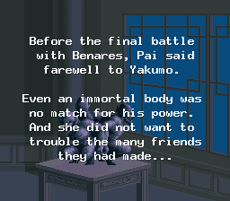
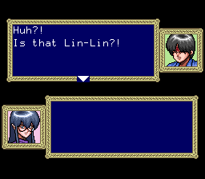
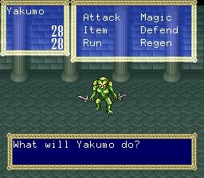
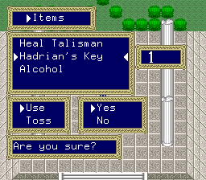
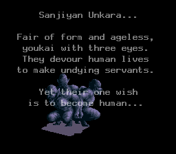

# 3x3 Eyes: Seima Kourinden — English fan translation (SNES)

An English translation of *3x3 Eyes: Seima Kourinden* (Super Famicom, 1992).

## About

This is a personal project. I wanted to play this game, and earlier attempts to translate it never
came to fruition, so I decided to do it myself. It was made possible by recent advances in AI:
the ROM analysis, tools and translation were done with the help of Claude (Anthropic).

## Screenshots

| | | |
|---|---|---|
|  |  |  |
| Intro | Dialogue | Battle |
|  |  | |
| Items menu | Game over | |

## Status

Work in progress, but playable from start to end in English:

- Full script translated (826 messages), plus menus, battle text, item, spell, enemy and location names.
- Graphic text screens translated: intro, Yakumo's monologue, cutscene lines and game over.
- Still being revised while playing. Title graphics and some kanji graphics (e.g. city names) are still in Japanese.

## What is (and isn't) here

This repository contains only the tools and the translation. It does **not** contain the game ROM or any
original game content. You need your own copy of the game.

## Building the translated ROM

Requirements:

- The original Japanese ROM, `3x3 Eyes - Seima Kourinden (Japan).sfc`
  (1 MB, unheadered, CRC32 `FBF3C0FF`; a 512-byte copier header is removed automatically).
- [Python 3](https://www.python.org/) (tested with 3.12).
- [Asar](https://github.com/RPGHacker/asar) 1.91: put `asar.exe` (and its DLL) in `ferramentas/asar/`.

Then run:

```
python ferramentas/build.py "path/to/3x3 Eyes - Seima Kourinden (Japan).sfc"
```

The result is `3x3Eyes_EN.sfc` in the repository folder (2 MB). The original ROM is not modified.
Tested on the Mesen 2 emulator.

A ready-to-apply `.bps` patch will be published in the Releases when the translation is finished.

## Repository layout

| Path | Contents |
|---|---|
| `traducao_en.txt` | Translated script |
| `nomes_en.tsv`, `menus_en.tsv`, `campos_en.tsv`, `blocos_en.txt` | Names, menus, locations, rewritten menu blocks |
| `intro_en.txt` | Graphic text screens |
| `glossario.md` | Glossary of names and terms |
| `ferramentas/` | Build pipeline, ASM patch (`hack.asm`) and generators |
| `ferramentas/analise/` | Research tools (decompressor, disassembler, trace and save state helpers) |
| `DOCUMENTACAO.md`, `ESTADO.md` | Technical documentation and project status (in Portuguese) |

## Credits

- Translation and hacking: JAOT, with Claude (Anthropic).
- The walkthrough by ritchie on GameFAQs was used as a reference for names and progression.

## Disclaimer

This is an unofficial, non-commercial fan project, not affiliated with the original publisher or the
rights holders of *3x3 Eyes*. Please support the official releases. Do not ask for ROMs.
